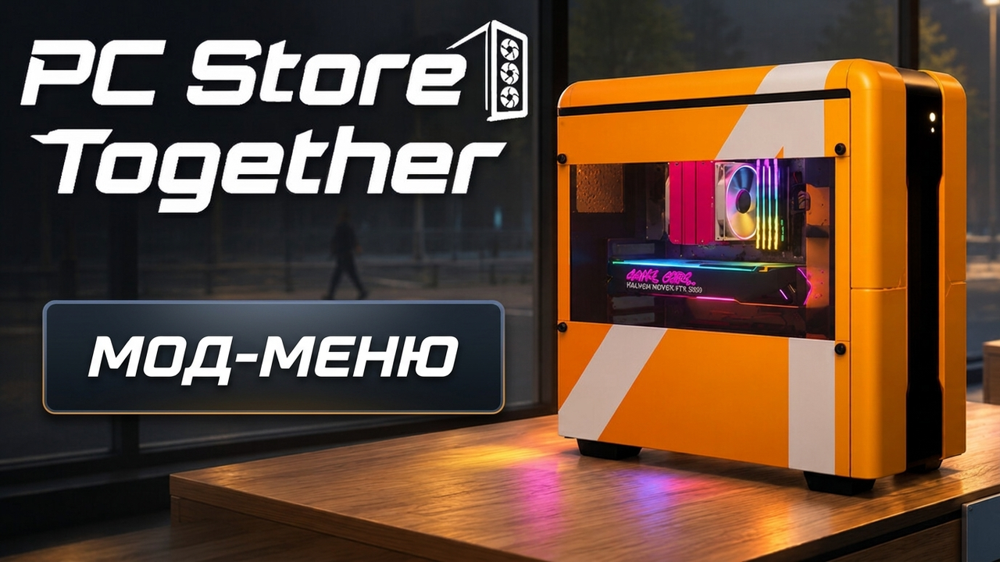
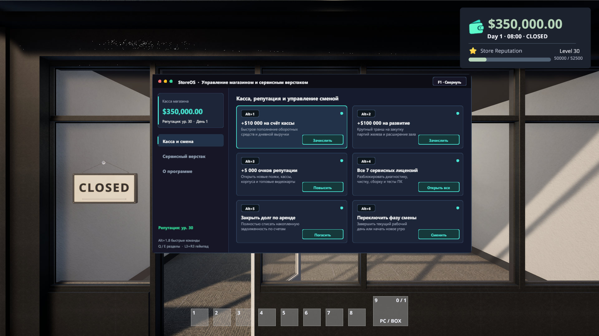
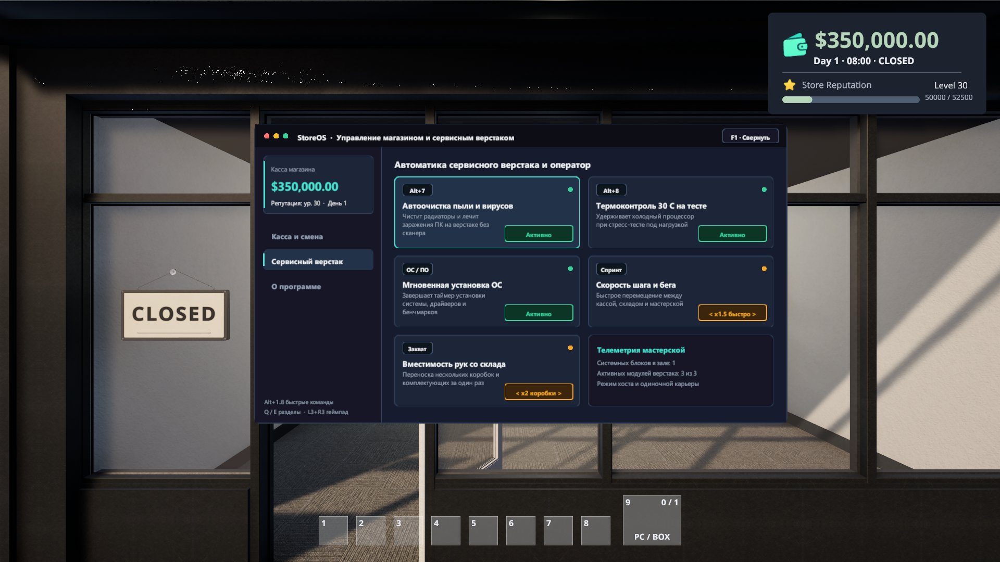
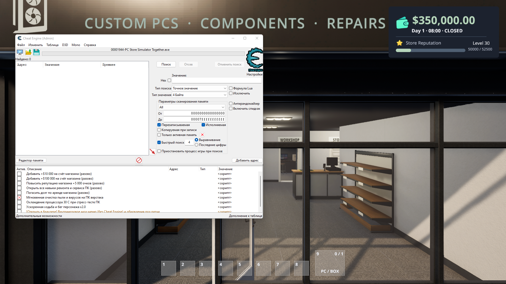
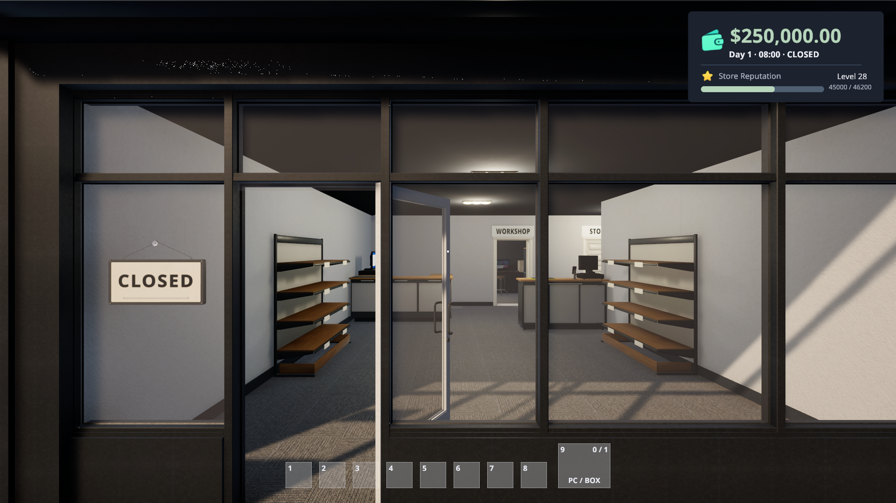

# PC Store Together - Мод-меню StoreOS и таблица Cheat Engine (v1.0)

Мод-меню StoreOS на русском, стартовое сохранение карьеры на 250 000 $ и таблица Cheat Engine для **PC Store Together** (сборка `26903133`, Windows и Steam Deck).

## Скачать
- **[Скачать мод-меню v1.0 (ZIP)](https://github.com/neoru-droid/pc-store-together-mod-ru/releases/download/v1.0.0/PCStoreTogether-Trainer-RU-v1.0.zip)** · [Таблица .CT и другие файлы на GitHub Releases](https://github.com/neoru-droid/pc-store-together-mod-ru/releases)
- **[Страница игры и все архивы на Boosty](https://boosty.to/cd_tixo/posts/6a6f1442-48c9-4107-94a0-0d108e2b061b)**
- **Ранний доступ и заказ своей игры:** новинки на 7 дней раньше от `120 ₽`, своя игра в очередь - `350 ₽`, разбор вне очереди - `750 ₽` на [Boosty](https://boosty.to/cd_tixo)

## Возможности мод-меню StoreOS

- **Магазин и финансы (`Alt+1..6`):** +10 000 $ и +100 000 $ на счёт магазина, +5 000 очков репутации, открытие всех навыков ремонта и сервиса ПК, погашение долга по аренде и завершение рабочего дня.
- **Верстак и персонаж:** мгновенная очистка пыли и вирусов на ПК верстака (`Alt+7`), холодный процессор `30 C` при стресс-тесте (`Alt+8`), скорость бега (`x1.0 / x1.5 / x2.2`), переноска коробок (`x1 / x2 / x3`) и быстрая установка ОС.
- **Управление:** окно StoreOS открывается по `F1`, `F2` или `L3 + R3` на геймпаде.

## Таблица Cheat Engine и стартовое сохранение

- **PCStoreTogether-CheatTable-RU-v1.0.zip:** 8 скриптов на русском для Cheat Engine 7.5+ (`PC Store Simulator Together.exe`).
- **PCStoreTogether-Save-v1.0.zip:** готовый 1-й слот карьеры (`shop-1.json`) с бюджетом 250 000 $, 28 уровнем репутации и открытыми навыками ремонта.

## Установка

1. **Windows:** закройте игру, распакуйте архив и запустите `PCStoreTogether-Trainer-Setup.exe` -> «Установить мод-меню».
2. **Steam Deck / Linux:** выполните `sh install-steamdeck.sh`.
3. **Откат:** нажмите «Удалить мод-меню» в установщике (или `sh install-steamdeck.sh --uninstall`).

Все проекты автора: [сайт каталога](https://neoru-droid.github.io/) · [каталог на Boosty](https://boosty.to/cd_tixo) · [Telegram](https://t.me/neoru_droid) · [профиль на GitHub](https://github.com/neoru-droid)

Лицензия: [MIT](LICENSE)
